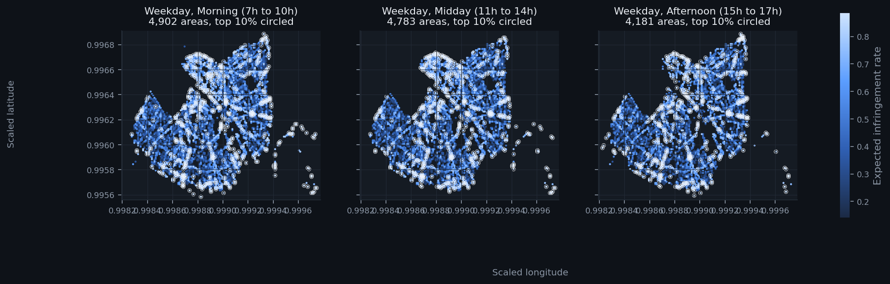
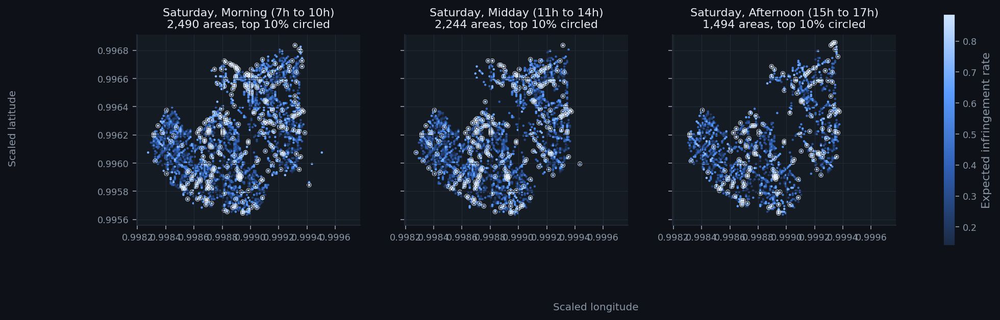

# Parking Enforcement Optimization

Where should a parking enforcement car go at 9 on a Tuesday morning? I built a model that ranks small areas of a city by the infringement rate it expects, for a given day and time, so the cars can start with the places that matter most.



*Weekdays, three time slots. Each dot is a small area of the city, brighter means more infringements expected, circled dots are the top 10%.*

## The problem in plain words

Cars with cameras drive through the streets and photograph parked vehicles. The plate number, the position and the time are then used to check whether the parking was valid, and a fine follows if not. The operator has to check every paid space about twice a day, but cars cannot be everywhere at once, so the order of visits matters.

Egis, an engineering group that runs this kind of service for several cities, turned the question into a public data challenge (Challenge Data, ENS and Collège de France, number 163, season 2026). For each check the data gives a scaled GPS position, the hour, the day, the month, the weather and the number of vehicles checked. The thing to predict is the share of those vehicles that were in infringement.

The score is the Spearman correlation between my predictions and the truth. It only looks at the order, not at the exact values, which fits the use: what matters is which places come first.

## What I found

Almost everything is about where. Coordinates are almost never repeated (2.5 million distinct points in the training data), so I cut the city into a grid of small cells at four sizes and computed the average infringement rate of each cell. Cells with few checks are noisy, so each cell is pulled toward the average of the larger cell around it, more strongly when it has little data. A gradient boosting model (LightGBM) then adds the hour, the day and the weather on top.

I validate on time: I fit on earlier months and score on later months, and every statistic that uses the answer is computed on the fit part only.

| Model | Spearman, months 10 to 12 |
|-------|---------------------------|
| Challenge benchmark (random forest, 10 trees, rows with at least 45 checks only, quoted from the challenge, not recomputed on my split) | 0.197 |
| Average rate per coarse cell | 0.507 |
| Average rate per fine cell | 0.610 |
| Fine cell pulled toward its coarser cell | 0.619 |
| Four nested cell sizes | 0.624 |
| Same statistics plus LightGBM | 0.629 |

The same model on three different validation periods:

| Fit months | Validation months | Statistics only | With LightGBM |
|-----------|-------------------|-----------------|---------------|
| 1 to 3 | 4 to 6 | 0.617 | 0.626 |
| 1 to 6 | 7 to 9 | 0.617 | 0.623 |
| 1 to 9 | 10 to 12 | 0.624 | 0.629 |

Most of the work is done by the cell statistics, and the learner adds 0.005 to 0.009. The weak spot is rows with a single checked vehicle: their ratio is 0 or 1, so even a perfect ranking cannot pass about 0.84 and the model reaches 0.48. Rows with 45 checks or more reach 0.73.

### The public score

My first submission scored **0.6051** on the public leaderboard, where the best public score at that date was 0.6247. That is lower than my validation, and I do not know why. I ruled out one cause, the season: the test months are 1 to 5, and fitting on months 6 to 12 then validating on months 1 to 5 gives 0.637. The rest is open: the public subset may be particular, rates may drift from one year to the next, or my validation may be too optimistic. The private ranking will give a second measure. I did not tune anything on the public score.

## Reading the map

For each day type and time slot, I average the predicted rate of the test rows in every cell and circle the top 10%. The result is a ranking of places to visit first, not a measured rate. The same view is available as a small interactive app (see below), with a short explanation next to it.



## What did not work

| Idea | Result |
|------|--------|
| Tune LightGBM one parameter at a time | No setting improves the score by more than 0.001 |
| Add a statistic per cell and hour | Same scores on the three periods: no interaction between place and hour |
| Add the number of checks to the statistical model | Worse (0.578 to 0.607 against 0.624) |
| Compute cell averages only from rows with many checks, as the benchmark does | Much worse (0.133 with 45 checks or more against 0.610) |

## Limits

- The public score is below my validation and I could not explain the gap.
- The map ranks model predictions. Cells with few checks are noisy.
- The data covers one year, so I cannot test how rates change from one year to the next.
- About 400 test rows (0.02%) sit at a few invalid GPS positions, far outside the city. The 399 training rows at such positions have an infringement ratio of 0.997 on average, so the model gives the test ones very high predictions (0.96). I leave them out of the maps and the app, since they are not real places.
- Two comparisons in the code are not forward-time validations and I do not use them to choose anything: the leave-one-month-out scheme (a row's statistics use later months too) and the season check that fits on months 6 to 12 and scores months 1 to 5. Every reported validation score uses the expanding window on earlier months only.
- Cell sizes, the shrinkage strength and the time slots are my choices, tuned on validation months only.
- The app reads a table built from the challenge test file, so it needs the data to run.

## Words used here

- **Spearman correlation**: compares two rankings. 1 means the same order, 0 means unrelated.
- **Cell**: a small square of the city on a regular grid.
- **Shrinkage**: when a cell has little data, I trust the larger area around it more than the cell's own average.
- **Leakage**: letting information from the answer reach the model by accident. Time-based validation and statistics computed on the fit part only prevent it.

## Data

The data comes from the challenge and cannot be redistributed, so it is not in this repository. Download it from the challenge page and place `x_train.csv`, `y_train.csv` and `x_test.csv` in `data/raw/`.

The training set has 6,076,546 rows over months 1 to 12, the test set 2,028,750 rows over months 1 to 5. A quarter of the rows have a single checked vehicle and only 1.8% have 45 or more. Only 53% of the test positions exist in the training data, which is why the model works with cells and not with exact points.

## Repository

```
src/parking/     grid cells, shrinkage, out of fold statistics, priority areas, colours
scripts/         one script per experiment, final fit, map
app/             interactive app
tests/           tests on small synthetic data
notebooks/       exploratory analysis
docs/            figures and data notes
```

## Run it

```bash
python -m venv .venv && source .venv/bin/activate
pip install -r requirements.txt
export PYTHONPATH=src

pytest -q                                     # tests on synthetic data
python scripts/rolling_folds.py 3 expanding   # one validation period
python scripts/final_predict.py               # fit on all months, predict the test set
python scripts/priority_map.py                # priority table and figures

pip install -r requirements-app.txt
streamlit run app/streamlit_app.py            # interactive app
```

## License

MIT, see `LICENSE`.

All random choices use seed 42. Built with Python, pandas, NumPy, LightGBM, scikit-learn, SciPy, matplotlib and Streamlit, checked with pytest and ruff.
